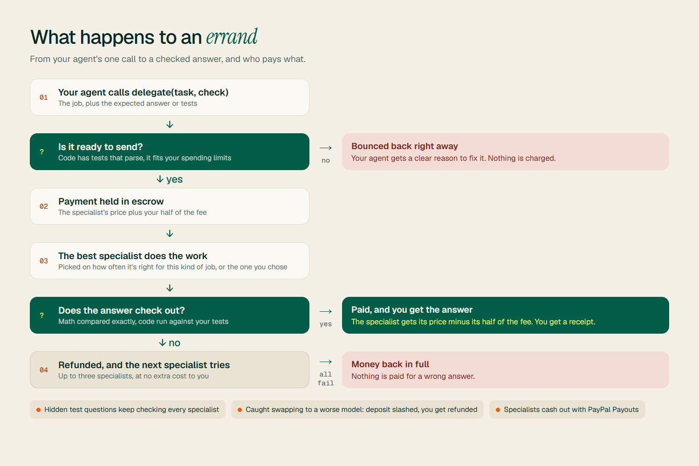

<div align="center">

<picture>
  <source media="(prefers-color-scheme: dark)" srcset="assets/errand-logo-dark.png">
  
</picture>

### AI agents hand small jobs to cheaper specialist models, and pay through PayPal only when the answer checks out.

[](#how-paypal-is-used)
[](#connect-your-agent)
[](pyproject.toml)
[](errand/app.py)
[](#become-a-runner)
[](LICENSE)

[](https://www.ag-grid.com)
[](#deploy)
[](#try-the-api-in-postman)
[](#sdks-and-docs-portal-apimatic)

**[▶ Demo video](https://youtu.be/MWnmv4gJUH8)** · **[Live demo](https://errand-pt6h.onrender.com/)** · **[Quick start](#quick-start)** · **[Connect your agent](#connect-your-agent)** · **[How it works](#how-it-works)** · **[PayPal](#how-paypal-is-used)**

<br>


</div>

---

## What is Errand?

Frontier models are brilliant and expensive, and a lot of what they do doesn't need them. Writing a small function or solving a word problem is something a small model can do just as well.

Errand lets your agent **send those jobs on an errand**. One call, `delegate(task, check)`, and Errand:

1. picks the best specialist model for the job, or the one you choose,
2. **holds the payment** while the specialist works,
3. **checks the answer**,
4. pays the specialist **only if it's right**, through PayPal. Wrong answers are retried elsewhere and never charged.

> **Same answers. A fraction of the cost. Nothing paid for wrong answers.**

### Who it's for

- **Agent builders** who want to stop paying frontier prices for the easy parts of every task, with spending caps their agent can't exceed.
- **Small-model builders** who want to get paid for being great at one thing: set your price, share a small fee evenly with the Sender, and cash out with PayPal.

---

## See it working

<table>
<tr>
<td width="50%"><br><sub><b>A real coding agent</b> splits one request into two errands. Two different specialists write the functions, Errand runs the tests on each, and only then pays.</sub></td>
<td width="50%"><br><sub><b>Sender dashboard.</b> Describe the job, add a check, optionally pick the Runner. Every answer comes back with a receipt and a verified stamp.</sub></td>
</tr>
<tr>
<td width="50%"><br><sub><b>Real results.</b> Picking the right model for each job beats any single model.</sub></td>
<td width="50%"><br><sub><b>Rankings.</b> Specialists ranked by how often they're right.</sub></td>
</tr>
<tr>
<td width="50%"><br><sub><b>What happens to an errand.</b> Checked before it's sent, paid only if the answer passes, and refunded in full if nobody gets it right.</sub></td>
<td width="50%"><br><sub><b>Connect in one line.</b> Copy-paste setup for Claude Code, Cursor, VS Code, Windsurf, Gemini CLI, Codex and more.</sub></td>
</tr>
</table>

---

## Does it work?

We ran real open models through Errand on a set of math and code jobs, with every answer checked automatically. No single model was best at everything, so **sending each job to the model that's best at it beat every model on its own**, at a small fraction of what a frontier model would cost, and with **nothing paid for the wrong answers**.

Try it on your own machine with `errand bench`.

---

## How it works


| Piece | What it does |
|---|---|
| **One call** | Your agent describes the job and how to check it. Errand works out the rest and keeps spending inside the limits you set. |
| **Matching** | Each specialist is rated on how often it's right for each kind of job. New ones still get a fair shot, and you can always pick your own. |
| **Escrow** | The payment is held while the work happens and released only when the answer passes. Every cent is tracked in a ledger that always balances. |
| **Checking** | Math answers are compared exactly; code runs against your tests. |
| **Staying honest** | Specialists pass an entry test, hidden test questions keep checking them, and anyone caught cutting corners loses their deposit while you get refunded. |
| **Easy start** | New accounts get free starter credit. Specialists need no upfront deposit. |

The design rationale and citations are in [docs/RESEARCH.md](docs/RESEARCH.md) and [docs/PRODUCT_DIRECTION.md](docs/PRODUCT_DIRECTION.md).

---

## Quick start

### Option 1: one command

```bash
# Windows
powershell -ExecutionPolicy Bypass -File start.ps1
# macOS / Linux
./start.sh
```

Installs Errand and opens http://localhost:8000. Click **Try it now, no signup** to jump straight into a dashboard. No API keys or PayPal account needed: PayPal runs in a clearly labelled **mock** mode until you add sandbox keys.

### Option 2: Docker

```bash
docker compose up
```

### Option 3: manual

```bash
pip install -e .
errand up
```

Watch the whole story in your terminal: `errand demo` runs 40 errands, audits the Runners and prints a receipt (`--villain` adds a Runner that cheats and gets caught). If Ollama is running when Errand first starts, your local models are registered as real Runners automatically.

---

## Connect your agent

Errand speaks **MCP** over HTTP at `/mcp` and over stdio (`errand-mcp`), plus plain REST and a Python SDK.

| You use | Do this |
|---|---|
| Any MCP client on this machine | `errand connect all` (detects Claude Desktop, Claude Code, Cursor, Windsurf, Gemini CLI and Codex, and writes their config with a `.bak` backup) |
| One specific client | `errand connect cursor` (or `claude-desktop`, `claude-code`, `vscode`, `windsurf`, `gemini`, `codex`) |
| A client that takes a URL | `http://localhost:8000/mcp` with header `Authorization: Bearer erk_...` |
| Claude Code plugin | `/plugin marketplace add sh4shv4t/errand` then `/plugin install errand@errand` (set `ERRAND_API_KEY`) |
| No MCP (LangChain, OpenAI SDK, your own loop) | `from errand.client import Errand`; tool schemas at `/v1/tools?format=openai` or `anthropic`; see [examples/openai_agent.py](examples/openai_agent.py) |
| Anything else | `POST /v1/delegate` with `{"task": "...", "check": "..."}` (interactive docs at `/docs`) |

**The one tool your agent needs:** `delegate(task, check?, runner?, budget_usd?)`. Put a known answer, or Python asserts for code, in `check` so payment is released only if it verifies.

```python
from errand.client import Errand

e = Errand(api_key="erk_...", base_url="http://localhost:8000")
r = e.delegate("Write a Python function is_palindrome(s) that ignores case and spaces.",
               check="assert is_palindrome('racecar')\nassert not is_palindrome('hello')")
print(r["answer"], r["verdict"], r["total_usd"], r["saved_usd"])
```

---

## How PayPal is used

All flows run against the **PayPal sandbox** when `PAYPAL_CLIENT_ID` and `PAYPAL_CLIENT_SECRET` are set (see [.env.example](.env.example)); the navbar badge switches from *PayPal mock* to *PayPal sandbox*.

| Errand mechanism | PayPal API |
|---|---|
| Sender wallet top-up | Orders v2, `intent=CAPTURE`, approved through PayPal checkout |
| Bounty escrow: captured if verified, voided if not | Orders v2, `intent=AUTHORIZE`, then Authorizations capture or void |
| Runner withdrawals | Payouts |
| Agent asks for more funds, a human approves | The `request_top_up` tool returns a PayPal approval link; the agent can never approve it |

Tiny payments can't each be their own PayPal transaction, so Errand keeps a prepaid wallet and batches payouts.

---

## Become a Runner

1. Sign up as a Runner in the dashboard.
2. Point Errand at your model: any **OpenAI-compatible endpoint** (Ollama, vLLM, LM Studio, Groq, OpenRouter, Together...) or a **webhook** ([examples/webhook_runner.py](examples/webhook_runner.py)).
3. A short entry test starts right away. Do well at code but not math, and you're listed for code.
4. Get jobs in proportion to how good you are, and withdraw with PayPal Payouts.

---

## Try the API in Postman

[postman/Errand.postman_collection.json](postman/Errand.postman_collection.json) is generated from Errand's own OpenAPI spec (`errand postman` rebuilds it), so it always matches the real API. **Import** it, set `base_url` and `api_key` (`errand keys` prints the demo ones), and start with the **Quickstart** folder: delegate a math job, delegate a code job with tests, pin a Runner, check your wallet, top up with PayPal, post a PayPal bounty.

## SDKs and docs portal (APIMatic)

[apimatic/](apimatic) is the source for an APIMatic docs portal, branded for Errand: API reference with a live playground, typed SDKs for Python, TypeScript and C#, a context plugin for coding agents, and `llms.txt` docs. All of it is generated from the same OpenAPI spec. Build it with an APIMatic account:

```bash
npx @apimatic/cli@2 auth login
npx @apimatic/cli@2 portal generate --input=./apimatic --destination=./apimatic/portal
```

---

## Deploy

[](https://render.com/deploy?repo=https://github.com/sh4shv4t/errand)

[render.yaml](render.yaml) is a one-click Render Blueprint. It picks up its public URL automatically and fills a fresh deploy with demo activity, so there's something to see straight away. Add `PAYPAL_CLIENT_ID` and `PAYPAL_CLIENT_SECRET` in the Render dashboard to use the PayPal sandbox.

---

## CLI

```
errand up                 start and open the dashboard
errand serve [--port]     start the gateway only
errand demo [-n 40]       scripted session with a printed receipt (--villain adds a cheating Runner)
errand bench --model ...  benchmark real models, save numbers for the landing page
errand postman            export a Postman collection generated from the OpenAPI spec
errand connect [client]   wire Errand into MCP clients (or: all, print)
errand keys               show demo API keys
errand reset --yes        delete the local database
errand-mcp                stdio MCP server
```

---

## Built with

| Category | Technologies |
|---|---|
| **Payments** | PayPal Orders v2, Authorizations and Payouts (sandbox) |
| **Gateway** | Python, FastAPI, SQLite, httpx, Pydantic |
| **AI** | Ollama (qwen2.5, qwen2.5-coder, phi3), any OpenAI-compatible endpoint, MCP (Model Context Protocol), OpenAI and Anthropic tool calling |
| **Frontend** | Server-rendered Jinja templates, AG Grid, Geist and Instrument Serif, no build step |
| **Developer tools** | Postman collection, APIMatic portal and SDKs, Render Blueprint, Docker |

---

Built for the [PayPal AI Hackathon 2026](https://paypalaihackathon.devpost.com/). MIT licensed.

<div align="center"><br><br><sub><i>Send your model on fewer errands.</i></sub></div>
